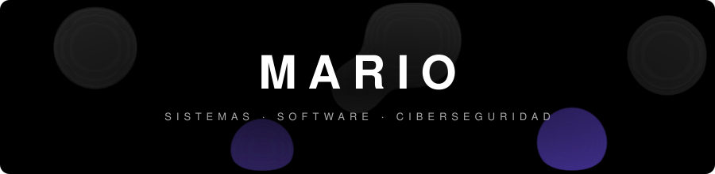
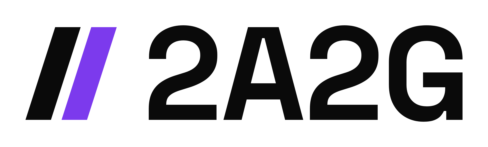

---

<table>
<tr>
<td width="200" align="center">

</td>
<td>

**Sobre mí**

Construyo software, administro sistemas y me interesa la seguridad.
Fundador de **2A2G**. Aprendiendo detección de intrusos con ML y arquitectura de software.

</td>
</tr>
</table>

---

STACK

---

PROYECTOS

  

| | |
|---|---|
| **NIDS** | Detección de intrusos con Zeek + Isolation Forest, Elasticsearch, Grafana y bloqueo automático por firewall |
| **Menuonl** | Menús y sitios para restaurantes |
| **2A2G** | Empresa de desarrollo de software |

---

  

