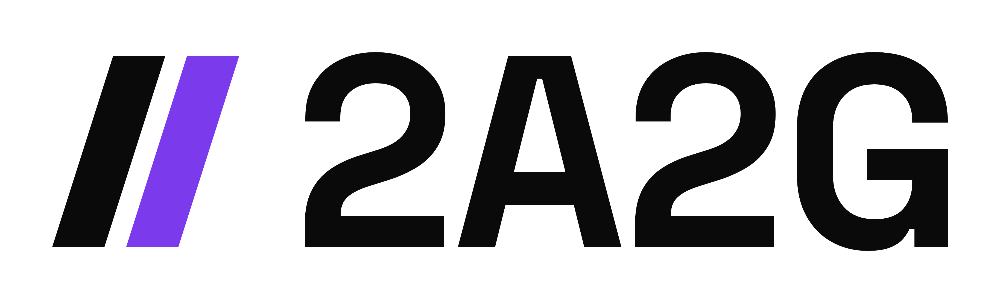

  

SOBRE MÍ

<table>
<tr>
<td align="center" width="190">

</td>
<td>

Construyo software, administro servidores y me enfoco en seguridad defensiva. Fundador de **2A2G**. Hoy construyo **VELORA**, un sistema de detección de intrusos con machine learning.

Ahora aprendiendo: Docker · Ubuntu Server · detección de anomalías · C++

</td>
</tr>
</table>

 

LENGUAJES

SISTEMAS

SEGURIDAD · DATOS

FRAMEWORKS · HERRAMIENTAS

  

PROYECTOS

  

<picture>
  <source media="(prefers-color-scheme: dark)" srcset="2a2g-dark.svg" />
  <source media="(prefers-color-scheme: light)" srcset="2a2g.png" />
  
</picture>

  

<table>
<tr><td><b>VELORA</b></td><td>IA defensiva: detección de intrusos con ML y bloqueo automático</td><td>en desarrollo</td></tr>
<tr><td><b>SunCity</b></td><td>Islas de calor urbano en Sonora · NASA Space Apps 2026</td><td><a href="https://suncity.2a2gcompany.com">ver</a></td></tr>
<tr><td><b>Menubly</b></td><td>Menús digitales para restaurantes (QR / NFC)</td><td><a href="https://menubly.2a2gcompany.com">ver</a></td></tr>
<tr><td><b>Misión Copechi</b></td><td>Juego pixel-art educativo para niños · hackathon</td><td><a href="https://github.com/MarioJavaScript/Copechi">repo</a></td></tr>
<tr><td><b>Nexora</b></td><td>Survival cooperativo en primera persona · C++</td><td>en desarrollo</td></tr>
<tr><td><b>2A2G</b></td><td>Sistemas a la medida, puntos de venta y web</td><td><a href="https://2a2gcompany.com">ver</a></td></tr>
</table>

 

CONTACTO

 

  

